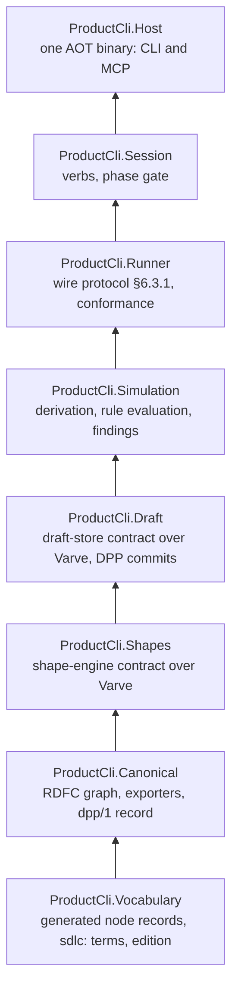

# ADR-0002: Fixed layers, dependencies strictly downward

**Status:** Accepted (2026-10-30)
**Date:** 2026-10-30
**Definition:** chapters 6 and 7

## Context

The five contracts of chapter 6 are the only seams. Varve's discipline applies: fixed layers, dependencies strictly downward, no grab-bag packages, public API baselines, and every rule an analyzer that fails the build. Two dependencies fix part of the order:

- W1 refuses at write, so the draft store depends on the shape engine.
- Exporters see only the canonical graph (D1.2), so canonicalisation sits below everything that writes.

## Decision

- **D1. Layer order.** The layers, from the bottom:

- **D2. What each layer may reference.** A layer references only layers below it, Varve, and the base class library. The generator project `ProductCli.Vocabulary.Generator` is an analyzer-time dependency of `Vocabulary` only.
- **D3. Enforcement.** Layering is enforced by an analyzer that fails the build: Varve's, if it can be reused by package, otherwise a local one. Every library has a public API baseline.
- **D4. The reference runner.** The C# reference runner of the runner-protocol contract is a test fixture, not part of the shipped binary.
- **D5. Generic RDF stays in Varve.** RDF terms, RDFC-1.0 and the canonical hash law come from Varve. If Varve lacks one of them, that is a Varve issue; nothing generic is implemented here, and nothing product-specific goes into Varve.

## Alternatives considered

- **One library plus a host.** Rejected: contracts become conventions, and the analyzer has nothing to enforce.
- **Shapes above Draft, validating after commit.** Rejected: that contradicts W1 (refusal at write).
- **Exporters in the Host.** Rejected: the canonical writer is what W7 and W8 test, and it must be testable without a process.

## Consequences

- Slice 0 creates the eight projects. Each is empty apart from its public API baseline and one test proving the analyzer rejects an upward reference.
- The layering analyzer is the first rule to fail the build.
