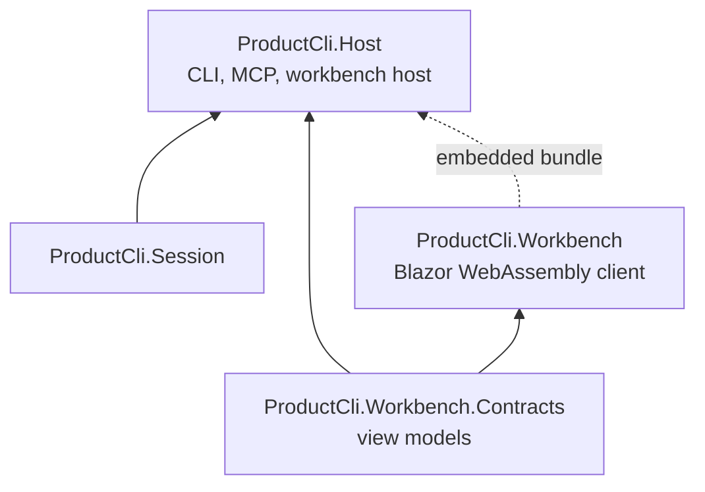

# ADR-0010: The workbench is a Blazor WebAssembly client served by the AOT binary

**Status:** Accepted (2026-10-30)
**Date:** 2026-10-30
**Definition:** D1.10, D1.13 (chapter 1, chapter 3 "The workbench", chapter 7)
**Amends:** ADR-0002 (a client and a contracts library beside the layers), ADR-0003 (the binary serves a browser client)

## Context

The point of the product is authoring the What in conversation with an agent while the author watches the graph change and adopts each step (D1.10). That needs a live view in a browser, beside the conversation. The constraints:

- One Native AOT binary, no shared server (ADR-0003).
- All C# (project constraint 5): no Node build, no JavaScript framework.
- ASP.NET Core's Native AOT compatibility table (aspnetcore-10.0 docs) lists Blazor Server and MVC as not supported, Minimal APIs and SignalR as partially supported, and StaticFiles as supported. SignalR's AOT support is JSON protocol only, with System.Text.Json source generation.
- The view must update whoever writes: the CLI, an agent over stdio MCP, or an agent over HTTP MCP, which can be three processes.

## Decision

- **D1. Blazor WebAssembly.** The workbench is a Blazor WebAssembly app, `ProductCli.Workbench`, compiled to a static bundle at build time and embedded in the binary as resources. The binary serves it with StaticFiles. Blazor Server is not used.
- **D2. The host.** `product view` and `product mcp --http` start an ASP.NET Core host from the slim builder: StaticFiles for the bundle, minimal APIs for reads and for the two writes, and server-sent events for updates. It binds to localhost by default. Exposing it beyond localhost is a later ADR; it needs authentication this ADR does not design.
- **D3. Follow the log, not the writer.** The host follows the draft log's head through the draft-store contract and pushes a notification per new position. Any writer in any process updates every open workbench.
- **D4. Server-sent events, not SignalR.** Updates are one-way, server to browser. Server-sent events need only a minimal-API endpoint. SignalR would add a hub, a partially supported AOT surface and its JSON-only constraint for no gain.
- **D5. Writes through the verbs.** The workbench's only writes are adopt and reject. Its endpoints call the authoring session as the author, the same path as `product proposal adopt|reject`. W1, W9 and W12 keep one enforcement point.
- **D6. The client loads no store.** The WebAssembly client never references Varve, the shapes or the simulator. It receives view models over the API. They are defined in `ProductCli.Workbench.Contracts`, a small trimmable library referenced by the host and the client. It has no dependency on the layers.
- **D7. The API is internal.** The browser API ships with the binary and changes with it. It is not a format, not under read-forever, and nothing outside the binary may depend on it. The supported ways in from outside remain the CLI, MCP and the exports.
- **D8. One design, two deliveries.** Customer presentation is a derived exporter (`--format html`, unstable per ADR-0008) built from the same components. Whether those components can be pre-rendered to static HTML inside the AOT host is unverified. The fallback is a snapshot of the WebAssembly bundle with the canonical graph embedded. Decided in the exporter's own ADR.

Placement beside ADR-0002's layers:

## Alternatives considered

- **Blazor Server.** Rejected: not supported under Native AOT.
- **A JavaScript single-page app.** Rejected: breaks constraint 5 and adds a Node toolchain.
- **Server-rendered HTML fragments over server-sent events.** Smaller payload and no WebAssembly. Rejected: component ergonomics matter for a view meant to impress customers, and both stay all C#. This was the earlier proposal.
- **The view inside the MCP host only.** Rejected: an agent on stdio MCP and a CLI user would see nothing. Following the log (D3) works for every writer.
- **A separate workbench binary.** Rejected: two binaries, two release paths, and the same host code twice.

## Consequences

- The binary grows by the WebAssembly bundle, several megabytes. The view starts more slowly than server-rendered HTML; acceptable for a local tool.
- CI builds the WebAssembly bundle before the AOT publish, and the smoke test opens the workbench and checks one live update.
- ADR-0004's register needs no package for this: ASP.NET Core and Blazor are part of the shared framework and SDK. Any component library for the client is a package with its own ADR.
- The visual design is its own piece of work, against this host. The exploration started in the earlier web-design session is its input.
