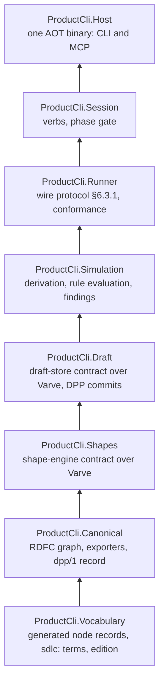
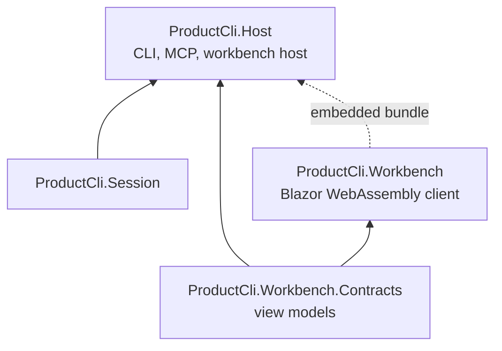

# product-cli — Architecture Decision Records

ADR-0001 to ADR-0012, all accepted 2026-10-30. Collected 2026-11-03 from the individual files; the text of each ADR is unchanged. Only this preamble was revised on 2026-11-03 to match Draft 4.

## Rulings changed since acceptance

These ADRs cite rulings that Draft 4 (D1.16 to D1.24, 2026-11-03) has since superseded or amended. When the ADRs are committed as files, each listed one gets the note below as a blockquote under its status lines. Nothing else in it changes.

- **ADR-0001.** D1 now reads `docs/decisions/ADR-####-<slug>.md` (D1.22). The first PR carries ADR-0001 to ADR-0012.
- **ADR-0008.** D1.7 is superseded by D1.16: the logic is artefacts held by digest, not triples in the graph. When this ADR is next touched:
  - an exporter's input becomes `CanonicalGraph` plus the logic artefacts its digests name, and D2's interface gains them;
  - the canonical export is the N-Quads plus those artefacts (D1.3 as amended);
  - D7's format IRI goes in this tool's dotted member (D1.17).
- **ADR-0009.** D1.4 is amended by D1.21:
  - the frozen input is pinned by graph hash at `rust-final` (`70395df`). The Rust tool has no `--canonical`, so D1's "canonical export" reads as `product domain export --product product-cli`;
  - D4 is amended. A `pf:` term outside the What (the How kinds) is dropped by name, with a reason, in the term map. A What term with no mapping still fails the migration;
  - wire names are authored by the lift's rule and adopted in review, not carried;
  - `acme-shop-4.ttl` is a second acceptance fixture, for behaviour;
  - D5's "untouched" now means read at the tag (D1.24).
- **ADR-0011.** D1.14 is superseded by D1.17. The What-version record takes `DDD-dec-63` §6's ruled shape:
  - `dk.decision-driven-design.sdlc` holds `edition`, `canon`, `graphHash` and `elements`;
  - this tool's own dotted member holds the format IRI, the simulation status and the logic artefacts;
  - `basedOn` pins every decision in force. That reverses the alternative this ADR rejected ("`basedOn` lists every adoption ever"). D1.17 accepts the size, which stays well under §3.1 for several thousand decisions, in exchange for a record whose `basedOn` is complete on its own.

## Index

- [ADR-0001: Record this repository's decisions as ADRs governed by an embedded Writ](#adr-0001-record-this-repositorys-decisions-as-adrs-governed-by-an-embedded-writ)
- [ADR-0002: Fixed layers, dependencies strictly downward](#adr-0002-fixed-layers-dependencies-strictly-downward)
- [ADR-0003: One Native AOT binary, gated in CI from the first commit](#adr-0003-one-native-aot-binary-gated-in-ci-from-the-first-commit)
- [ADR-0004: Package policy and register](#adr-0004-package-policy-and-register)
- [ADR-0005: One record per node kind, with a source generator](#adr-0005-one-record-per-node-kind-with-a-source-generator)
- [ADR-0006: Guarantee tests observe bytes, not return values](#adr-0006-guarantee-tests-observe-bytes-not-return-values)
- [ADR-0007: Commits, sessions and the main branch](#adr-0007-commits-sessions-and-the-main-branch)
- [ADR-0008: Exporters over the canonical graph](#adr-0008-exporters-over-the-canonical-graph)
- [ADR-0009: Acceptance through a one-time migration of the self-hosted What](#adr-0009-acceptance-through-a-one-time-migration-of-the-self-hosted-what)
- [ADR-0010: The workbench is a Blazor WebAssembly client served by the AOT binary](#adr-0010-the-workbench-is-a-blazor-webassembly-client-served-by-the-aot-binary)
- [ADR-0011: Agent writes are proposals; every change at the head is a `dpp/1` decision record](#adr-0011-agent-writes-are-proposals-every-change-at-the-head-is-a-dpp1-decision-record)
- [ADR-0012: Adopting on the fly — one action per adoption, wherever the author is](#adr-0012-adopting-on-the-fly--one-action-per-adoption-wherever-the-author-is)

---

## ADR-0001: Record this repository's decisions as ADRs governed by an embedded Writ

**Status:** Accepted (2026-10-30)
**Date:** 2026-10-30
**Definition:** chapter 8, "Decision-driven, like Writ"

### Context

product-cli signs nothing (W10), but the repository that builds it is governed. Chapter 8 requires an embedded `writ` from the first commit, ADRs in its log, code landed through `writ land`, and a baseline on day one. Writ's `land` may not exist when this repository starts. Writ resolved the same bootstrap problem with ADR-level discipline by review (Writ ADR 0008).

The old `.decisions/` ledger is Writ's authority graph now and is read once by `writ import`. Nothing here writes to it.

### Decision

- **D1. Where ADRs live.** Every architectural decision is an ADR under `adr/ADR-####-<slug>.md`, numbered from 0001. Each has Context, Decision as a numbered decision set (D1, D2, …), Alternatives considered, and Consequences.
- **D2. Writ from the first commit.** The repository embeds `writ` from the first commit that can hold it. Until then the ADR files are authoritative, by review, as in Writ ADR 0008. When the log can hold them, every accepted ADR is imported and a baseline is taken. From that point the log is authoritative and the files are its rendering.
- **D3. No silent divergence.** A proposal that contradicts an accepted ADR says so and supersedes it, naming the superseded ADR. It never diverges silently.
- **D4. Outside-in.** An ADR that changes the surface, formats, guarantees or contracts names the definition change it rides on, and the definition changes first. An ADR that needs a vocabulary change names the `sdlc:` edition requested in decision-driven-design.

### Alternatives considered

- **Keep `.decisions/`.** Rejected: it is Writ's authority graph now (chapter 8), and writing to it would make this tool a decision ledger.
- **Defer governance until Writ can land.** Rejected: decisions taken before the baseline would have no record. Review discipline costs little and is already proven in Writ.

### Consequences

- The first PR carries ADR-0001 to ADR-0011 as files.
- Importing them into the embedded log is a tracked follow-up, done once Writ can hold them.

---

## ADR-0002: Fixed layers, dependencies strictly downward

**Status:** Accepted (2026-10-30)
**Date:** 2026-10-30
**Definition:** chapters 6 and 7

### Context

The five contracts of chapter 6 are the only seams. Varve's discipline applies: fixed layers, dependencies strictly downward, no grab-bag packages, public API baselines, and every rule an analyzer that fails the build. Two dependencies fix part of the order:

- W1 refuses at write, so the draft store depends on the shape engine.
- Exporters see only the canonical graph (D1.2), so canonicalisation sits below everything that writes.

### Decision

- **D1. Layer order.** The layers, from the bottom:



- **D2. What each layer may reference.** A layer references only layers below it, Varve, and the base class library. The generator project `ProductCli.Vocabulary.Generator` is an analyzer-time dependency of `Vocabulary` only.
- **D3. Enforcement.** Layering is enforced by an analyzer that fails the build: Varve's, if it can be reused by package, otherwise a local one. Every library has a public API baseline.
- **D4. The reference runner.** The C# reference runner of the runner-protocol contract is a test fixture, not part of the shipped binary.
- **D5. Generic RDF stays in Varve.** RDF terms, RDFC-1.0 and the canonical hash law come from Varve. If Varve lacks one of them, that is a Varve issue; nothing generic is implemented here, and nothing product-specific goes into Varve.

### Alternatives considered

- **One library plus a host.** Rejected: contracts become conventions, and the analyzer has nothing to enforce.
- **Shapes above Draft, validating after commit.** Rejected: that contradicts W1 (refusal at write).
- **Exporters in the Host.** Rejected: the canonical writer is what W7 and W8 test, and it must be testable without a process.

### Consequences

- Slice 0 creates the eight projects. Each is empty apart from its public API baseline and one test proving the analyzer rejects an upward reference.
- The layering analyzer is the first rule to fail the build.

---

## ADR-0003: One Native AOT binary, gated in CI from the first commit

**Status:** Accepted (2026-10-30)
**Date:** 2026-10-30
**Definition:** chapter 7, Hosts and Constraints

### Context

The product is one Native AOT binary serving both CLI and MCP, with no server. AOT and trimming failures are cheap to fix when they appear and expensive once a dependency or a reflection pattern has spread. The Rust tool never had this constraint, so nothing in its behaviour reveals where .NET would break.

### Decision

- **D1. One binary.** `ProductCli.Host` publishes one Native AOT executable per supported runtime identifier. CLI, MCP (stdio and HTTP) and the workbench host (ADR-0010) are modes of that binary.
- **D2. Analyzers on everywhere.** Every library sets `IsAotCompatible` and `IsTrimmable`, and AOT and trim analyzer warnings are errors.
- **D3. CI publishes on every PR.** CI runs the AOT publish on every PR from the first commit and runs the published binary's smoke test. A PR that breaks AOT publish fails.
- **D4. No reflection.** No reflection-based serialisation. JSON uses System.Text.Json source generation. Registries (exporters, node kinds, verbs) are generated at compile time.
- **D5. Supported platforms.** The supported runtime identifiers are recorded in the build policy. W7 ("on every platform") is tested by running the canonical export fixtures on each of them in CI.

### Alternatives considered

- **JIT binary first, AOT later.** Rejected: the cost of AOT grows with every dependency and pattern added before the gate exists.
- **A separate MCP binary.** Rejected by chapter 7: one process, one binary.

### Consequences

- Package choices (ADR-0004) are filtered by AOT compatibility before anything else.
- W7's cross-platform clause becomes a CI matrix rather than an assertion.

---

## ADR-0004: Package policy and register

**Status:** Accepted (2026-10-30)
**Date:** 2026-10-30
**Definition:** chapter 7, Constraints

### Context

The project is 100% managed .NET, Varve's constraints 1 to 5 apply, and every third-party package needs an ADR. Versions are resolved from nuget.org, never from memory.

### Decision

- **D1. The build policy and register.** The repository adopts Varve's build policy and package register. Every `PackageReference` carries `Adr=` naming the ADR that admits it. The build fails on a package without one.
- **D2. Starting register.** The register starts with:
  - Varve, admitted by this ADR;
  - the test framework and the property-testing library, as test-only packages, admitted by this ADR once named in slice 0's plan, with the versions resolved from nuget.org.
- **D3. Two open choices, each deferred to its own ADR in the slice that needs it:**
  - **CLI argument parsing.** System.CommandLine, if its current release is trim- and AOT-clean, or a small hand-written parser over the fixed verb table. Decided in the nodes slice.
  - **MCP transport.** The official C# MCP SDK, if it is AOT-clean, or a minimal JSON-RPC over stdio and HTTP using System.Text.Json source generation. Decided in the MCP slice. My default is the hand-written one: the protocol surface is small, and AOT certainty outweighs the code saved.
- **D4. Central versions.** Package versions are pinned centrally. Upgrades are PRs with the register updated.

### Alternatives considered

- **Admit common packages up front.** Rejected: every package is a trust and AOT cost, and the register is only worth having if it records a reason for each entry.

### Consequences

- Slice 0 has exactly Varve plus test-only packages.
- Each later dependency arrives with its own ADR and its AOT evidence.

---

## ADR-0005: One record per node kind, with a source generator

**Status:** Accepted (2026-10-30)
**Date:** 2026-10-30
**Definition:** chapter 7, Node kinds

### Context

The Rust tool kept five hand-maintained parallel enumerations per node kind. It failed silently when one was missed. The definition designs that failure mode out rather than testing for it.

### Decision

- **D1. One record per kind.** Each node kind of the pinned `sdlc:` edition is one C# record in `ProductCli.Vocabulary`, annotated with its class IRI and the IRI of each property.
- **D2. Generated code.** A source generator emits, from those records alone:
  - the RDF writer to triples;
  - the parser from triples;
  - the kind registry used by `domain new`, `show` and `list`;
  - the shape binding (the shape IRI a record is checked against).
- **D3. Mismatches are compile errors.** A record whose IRIs do not exist in the pinned edition fails the build. The generator reads the edition's vocabulary file as an additional input. A kind in the edition with no record is a build warning listing it, so coverage of the vocabulary is visible.
- **D4. Canonicalisation is not generated.** The canonicaliser is not per kind: RDFC-1.0 runs over the graph, from Varve (ADR-0002, D5). Draft 1 listed the canonicaliser among the generated outputs; it does not need to be, and it should not be.

### Alternatives considered

- **Generate the records from the ontology.** Deferred. Records generated from `sdlc:` would make the vocabulary the single source outright. But the C# shape of a record (naming, optionality, collections) needs authoring decisions the ontology does not carry. Revisit once the `sdlc:` edition is pinned and its annotations are known.
- **Reflection over attributes at runtime.** Rejected by ADR-0003.

### Consequences

- Adding a node kind is one record.
- An edition change that renames a term breaks the build where the term is used, not silently at export.

---

## ADR-0006: Guarantee tests observe bytes, not return values

**Status:** Accepted (2026-10-30)
**Date:** 2026-10-30
**Definition:** chapter 5

### Context

In the Rust tool, two MCP status tools returned a success envelope without writing the file. Their tests checked the envelope and passed. Eleven updates were lost before anyone noticed. The cause was test scope, not implementation quality: a test that observes the return value accepts a stub.

### Decision

- **D1. What a guarantee test observes.** Every W-property test observes one of:
  - the draft log, read back through the draft-store contract at a position;
  - the bytes of an export;
  - the bytes on the runner's stdout;
  - the `dpp/1` records in the decisions directory (ADR-0011).
  None observes the return value of the verb under test.
- **D2. Failed writes.** A test of a refused write (W1, W2, W5) asserts that the log's head position and its bytes are unchanged, not only that an error was returned.
- **D3. Recorded in `AGENTS.md`.** The rule is in `AGENTS.md` and is checked in review. A test that only asserts on a verb's result is rejected.

### Alternatives considered

- **Leave it to review.** Rejected: that is what failed before.
- **An analyzer.** Desirable but not yet specified: it is hard to tell mechanically what a test observes. It stays a review rule until a pattern for an analyzer emerges.

### Consequences

- Guarantee tests are slightly heavier: they read back.
- A stub cannot pass them.

---

## ADR-0007: Commits, sessions and the main branch

**Status:** Accepted (2026-10-30)
**Date:** 2026-10-30
**Definition:** chapter 8, "Decision-driven, like Writ"

### Context

The repository follows the Writ and Varve pattern: signed agent commits, traceability per session, and a `main` that accepts only checked commits.

### Decision

- **D1. Commits.** Every commit is signed. Agent sessions sign as the agent identity, with no model identifiers in commits, trailers or records. Every commit carries `Refs #N` and a DCO sign-off.
- **D2. Sessions.** Every agent session leaves a traceability record:
  - what was read;
  - the approved plan;
  - the commits;
  - the checks run and their results;
  - anything deviating from the plan, with the reason.
- **D3. Pull requests.** One PR per slice or ADR change, with a release descriptor.
- **D4. Main.** `main` accepts only checked commits and is fast-forwarded at an approved head. Once Writ can land, through `writ land`.
- **D5. Parallel sessions.** When two sessions run in parallel, whichever lands second reconciles: it rebases, re-runs every check, and records the reconciliation in its traceability record.
- **D6. No suppression.** No rule is suppressed. A rule that is wrong is changed by ADR.

### Alternatives considered

None. This ADR adopts the existing Writ and Varve pattern rather than deciding a new one.

### Consequences

- `AGENTS.md` is the single source for these rules.
- The session prompt template refers to this ADR.

---

## ADR-0008: Exporters over the canonical graph

**Status:** Accepted (2026-10-30)
**Date:** 2026-10-30
**Definition:** D1.2, D1.3, D1.5, D1.7

### Context

The canonical document is the only thing that crosses the seam to Writ (W7, W8, W10). By D1.3, it is the RDFC-1.0 canonical N-Quads of the What graph. Other renderings of the same What are wanted, starting with graph serialisations, and adding one must be cheap. Three constraints apply:

- Native AOT rules out runtime plugins (ADR-0003).
- An export seam is where code generation would re-enter (chapter 8).
- Exporting must not become a sixth contract (chapter 6).

Changes from the 2026-10-27 draft:

- the canonical document is N-Quads, not Turtle;
- the manifest is the `dpp/1` What-version record (D1.1), not invented fields;
- the authored logic is in the graph (D1.7), so the input to exporters is complete;
- sorted Turtle replaces N-Triples as the second exporter, because N-Triples is near-identical to canonical N-Quads for the default graph and would prove nothing.

### Decision

- **D1. One pipeline.** Node records → triples → RDFC-1.0 → `CanonicalGraph` → exporter → bytes. `CanonicalGraph` is the pinned `sdlc:` edition plus the sorted, RDFC-labelled triple set of the default graph. Canonicalisation happens once.
- **D2. Exporters are pure functions over triples:**

```csharp
public interface IGraphExporter
{
    ExportFormat Format { get; }   // format IRI, media type, supported editions, stability
    void Write(CanonicalGraph graph, WhatVersionRecord source, IBufferWriter<byte> output);
}
```

  An exporter reads neither the draft log nor node-record internals.
- **D3. The canonical writer is exporter one.** The canonical N-Quads writer implements `IGraphExporter` with no special path. Its format IRI is the one Writ lands.
- **D4. Sorted Turtle is exporter two.** It ships in the same slice, with a spec page and a conformance suite: a fixed prefix set, subjects and predicates sorted. It proves the seam on a format with real serialisation choices (prefixes, grouping, literal forms). The exit check is that both writers run over `CanonicalGraph` with no special cases.
- **D5. Registration.** A source generator builds a static registry of exporters. No reflection.
- **D6. Edition refusal.** An exporter declares its supported editions and refuses any other, with a diagnostic.
- **D7. Derivation in the record.** Every export carries a `dpp/1` What-version record with its format IRI. Derived exports add `prov:wasDerivedFrom` naming the canonical content hash. These fields are fixed in the record's specification before the first release.
- **D8. Scope.** An exporter describes the What. Output that is executable, or that is parameterised by a realisation target, is code generation and is refused. This is a review rule, and every exporter ADR states which side of it the exporter falls on.
- **D9. Stability tiers.** Only formats with a spec page and a conformance suite are read-forever: canonical N-Quads and sorted Turtle. Others are marked unstable.
- **D10. Out of process.** `product domain export --canonical` on stdout is the interface for anything outside the binary.

### Alternatives considered

- **Exporters over typed records.** Rejected: it couples every exporter to edition-generated record shapes. A typed view, if ever needed, is a projection computed from `CanonicalGraph`.
- **Runtime plugins.** Impossible under AOT.
- **Canonical writer as a special path.** Rejected: the hardest case would be the untested one.
- **N-Triples as exporter two.** Rejected: near pass-through from canonical N-Quads, so it proves nothing.
- **JSON-LD as exporter two.** Deferred: context and compaction rules are a specification question of their own.

### Consequences

- W7 is enforced in one place.
- Adding an exporter costs one class, one spec page and its fixtures.
- Writ must accept N-Quads as the landable document (cross-repository dependency, D1.3).

### Open

- **IRI base for format identifiers.** Tool-owned, beside `sdlc:`, not in it. To be fixed in the `dpp/1` record's specification.

---

## ADR-0009: Acceptance through a one-time migration of the self-hosted What

**Status:** Accepted (2026-10-30)
**Date:** 2026-10-30
**Definition:** D1.4 (chapter 7, Acceptance)

### Context

Draft 1's acceptance test was byte identity with the Rust tool's export. D1.1 made that impossible: the Rust export uses `pf:` and its own IRIs, while the new tool exports `sdlc:` with flat ULID IRIs. Chapter 8 still carries the self-hosted What over as the first fixture, so it needs a path in.

### Decision

- **D1. A repository tool, not a verb.** `tools/migrate-pf` is a repository tool, not a product verb and not part of the shipped binary. It reads the Rust tool's canonical export of the self-hosted What. It maps `pf:` terms to `sdlc:` terms of the pinned edition, mints one element IRI per node, and writes three files:
  - the migrated document;
  - the term map;
  - the IRI map (old IRI → new IRI).
- **D2. Run once, commit the outputs.** The migration runs once. Its three outputs are committed as fixtures under `fixtures/self-hosted/` and never regenerated: ULIDs are minted once.
- **D3. The acceptance criterion.**
  1. The migrated document imports through W1 and passes the shapes of its edition.
  2. Its canonical export round-trips byte-identically (W8).
  3. The conformance suite passes.

  When all three hold, the Rust binary is retired, and `tools/migrate-pf` is deleted in the same PR.
- **D4. No mapping means no migration.** A `pf:` term with no `sdlc:` mapping fails the migration and names the term. It is resolved in decision-driven-design (an edition question), never by dropping triples.
- **D5. The Rust tool is untouched.** The Rust tool is read for its export bytes only; nothing in it changes.

### Alternatives considered

- **Graph isomorphism under the term and IRI map.** Rejected: it gives a weaker gate than byte identity, and the migrated document is needed as a fixture anyway.
- **Migration as a product verb (`product import --from-pf`).** Rejected: it would make `pf:` part of the surface, and the surface would then be read-forever for a retired vocabulary.

### Consequences

- Slice 3 of the order of work depends on the pinned edition having a mapping for every `pf:` term the self-hosted What uses.
- The term map doubles as a list of what `sdlc:` must cover.

---

## ADR-0010: The workbench is a Blazor WebAssembly client served by the AOT binary

**Status:** Accepted (2026-10-30)
**Date:** 2026-10-30
**Definition:** D1.10, D1.13 (chapter 1, chapter 3 "The workbench", chapter 7)
**Amends:** ADR-0002 (a client and a contracts library beside the layers), ADR-0003 (the binary serves a browser client)

### Context

The point of the product is authoring the What in conversation with an agent while the author watches the graph change and adopts each step (D1.10). That needs a live view in a browser, beside the conversation. The constraints:

- One Native AOT binary, no shared server (ADR-0003).
- All C# (project constraint 5): no Node build, no JavaScript framework.
- ASP.NET Core's Native AOT compatibility table (aspnetcore-10.0 docs) lists Blazor Server and MVC as not supported, Minimal APIs and SignalR as partially supported, and StaticFiles as supported. SignalR's AOT support is JSON protocol only, with System.Text.Json source generation.
- The view must update whoever writes: the CLI, an agent over stdio MCP, or an agent over HTTP MCP, which can be three processes.

### Decision

- **D1. Blazor WebAssembly.** The workbench is a Blazor WebAssembly app, `ProductCli.Workbench`, compiled to a static bundle at build time and embedded in the binary as resources. The binary serves it with StaticFiles. Blazor Server is not used.
- **D2. The host.** `product view` and `product mcp --http` start an ASP.NET Core host from the slim builder: StaticFiles for the bundle, minimal APIs for reads and for the two writes, and server-sent events for updates. It binds to localhost by default. Exposing it beyond localhost is a later ADR; it needs authentication this ADR does not design.
- **D3. Follow the log, not the writer.** The host follows the draft log's head through the draft-store contract and pushes a notification per new position. Any writer in any process updates every open workbench.
- **D4. Server-sent events, not SignalR.** Updates are one-way, server to browser. Server-sent events need only a minimal-API endpoint. SignalR would add a hub, a partially supported AOT surface and its JSON-only constraint for no gain.
- **D5. Writes through the verbs.** The workbench's only writes are adopt and reject. Its endpoints call the authoring session as the author, the same path as `product proposal adopt|reject`. W1, W9 and W12 keep one enforcement point.
- **D6. The client loads no store.** The WebAssembly client never references Varve, the shapes or the simulator. It receives view models over the API. They are defined in `ProductCli.Workbench.Contracts`, a small trimmable library referenced by the host and the client. It has no dependency on the layers.
- **D7. The API is internal.** The browser API ships with the binary and changes with it. It is not a format, not under read-forever, and nothing outside the binary may depend on it. The supported ways in from outside remain the CLI, MCP and the exports.
- **D8. One design, two deliveries.** Customer presentation is a derived exporter (`--format html`, unstable per ADR-0008) built from the same components. Whether those components can be pre-rendered to static HTML inside the AOT host is unverified. The fallback is a snapshot of the WebAssembly bundle with the canonical graph embedded. Decided in the exporter's own ADR.

Placement beside ADR-0002's layers:



### Alternatives considered

- **Blazor Server.** Rejected: not supported under Native AOT.
- **A JavaScript single-page app.** Rejected: breaks constraint 5 and adds a Node toolchain.
- **Server-rendered HTML fragments over server-sent events.** Smaller payload and no WebAssembly. Rejected: component ergonomics matter for a view meant to impress customers, and both stay all C#. This was the earlier proposal.
- **The view inside the MCP host only.** Rejected: an agent on stdio MCP and a CLI user would see nothing. Following the log (D3) works for every writer.
- **A separate workbench binary.** Rejected: two binaries, two release paths, and the same host code twice.

### Consequences

- The binary grows by the WebAssembly bundle, several megabytes. The view starts more slowly than server-rendered HTML; acceptable for a local tool.
- CI builds the WebAssembly bundle before the AOT publish, and the smoke test opens the workbench and checks one live update.
- ADR-0004's register needs no package for this: ASP.NET Core and Blazor are part of the shared framework and SDK. Any component library for the client is a package with its own ADR.
- The visual design is its own piece of work, against this host. The exploration started in the earlier web-design session is its input.

---

## ADR-0011: Agent writes are proposals; every change at the head is a `dpp/1` decision record

**Status:** Accepted (2026-10-30)
**Date:** 2026-10-30
**Definition:** D1.11, D1.12, D1.14 (chapter 3 "Proposals and decisions", chapter 4 "Decision records and the profile", W10 to W12)
**Rests on:** `dpp/1`, specification 1.0, draft of 2026-10-27 (decision-driven-design `spec/decision-provenance/dpp-1.md`)

### Context

The author should adopt each step the agent proposes, and that adoption should create provenance (D1.10). The protocol now lives in decision-driven-design as `dpp/1`, shared by any system that records decisions. What it fixes and what it leaves out decides the design:

- **One conformance class** (§8): a conformant system. There is no provenance class beside an authority class. Draft 2's W11 assumed one; it does not exist.
- **Authority is a profile matter.** Who may decide or accept, whether a decision binds, positions, sessions and any clock other than `at` are non-goals (§1.3), documented by each system in its profile (§9.4). Appendix B shows Writ-style acceptance as one such profile.
- **`why` is required.** A record without a non-empty `why` is not a record (§3.4).
- **Software is `by`.** Where software made the decision, `by` MUST be the software's identity, with the responsible person in `attributedTo` (§3.4).
- **Status values carry no force.** `status` is one of `proposed`, `accepted`, `superseded`, `withdrawn`; its meaning is the writer's profile's, and a reader MUST NOT infer force from it (§3.4).
- **Signatures are optional** and, when present, show only that a key signed the content, not entitlement (§11.3).
- **The file binding** (§6.6) lets a directory of records be a conformant system with no code.

So product-cli can record decisions as a conformant system and stay outside authority, with no key.

### Decision

- **D1. The draft log is a `dpp/1` system.** Each product's draft log exposes its records through the file binding at `.product/products/<name>/decisions/`, with a descriptor naming this tool's profile. Its system identifier is chosen once per draft log and never changes (§3.3).
- **D2. Proposals.** Every write verb on the agent surface creates a proposal: a change set, checked against the shapes (W1) and the phase gate (W9) on submission, and held beside the head. Its record is version 1 of a new decision:
  - `by`: the agent's identity as the MCP client declares it;
  - `attributedTo`: the author;
  - `status`: `proposed`;
  - `why`: the agent's reason. The MCP tool schema makes it a required argument.

  The change set's hash is pinned in a dotted member.
- **D3. Alternatives.** An agent may submit two or three proposals as alternatives. A dotted member names the set. They are separate decisions, so each keeps its own reason.
- **D4. Adoption.** Adoption is the next version of the proposal's decision:
  - `by`: the author;
  - `status`: `accepted`;
  - `why`: the author's reason, or `{ "ref": <the proposal> }` with the proposal pinned in `basedOn` (§3.4);
  - `supersedes`: the proposal version.

  The change set is re-checked against the current head before the commit. If it no longer holds, the adoption is refused and the proposal stays pending. Adopting one alternative writes a `withdrawn` version for each sibling, with `why` referring to the adopted one.
- **D5. Rejection.** Rejection is the next version with `status: withdrawn` and the author's reason. The workbench asks for a reason in one line. An empty reason is not offered, because the protocol does not allow one.
- **D6. Direct writes.** A write by the author at the CLI is a single record: `by` the author, `status: accepted`, `why` given with `--why`. There is no proposal step.
- **D7. The What-version record.** An export writes a What-version record (D1.14):
  - `basedOn` is the previous What-version plus every adoption and direct write since it, each pinned. The chain keeps records small and the walk complete.
  - The edition, format IRI, canonical hash and simulation status are in dotted members.
  - The draft position, the Varve header hash and the session identifier are in `extensions`.
- **D8. The profile.** This tool publishes its profile. It states:
  - `proposed` means an agent's suggestion;
  - `accepted` means adopted into this author's draft;
  - `withdrawn` means rejected or displaced by an alternative;
  - no record binds anyone, and an edge into this system from another carries provenance only;
  - the dotted members and `extensions` it writes;
  - the identity schemes in `by`: the author's comes from configuration as a URI; the agent's is self-declared and unauthenticated.
- **D9. No signatures.** Records are unsigned. Integrity rests on pins and the Git history of the decisions directory (§11.2). Signing by the author's key would be a later ADR; it would add integrity, never authority.
- **D10. Hashing.** The `dpp/1` hash law (§5) is implemented once and checked against the protocol's canonicalisation vectors. It is generic, so if Varve offers it, it comes from Varve (ADR-0002 D5); if not, that is a Varve issue first.

### Alternatives considered

- **Avoid `status: accepted`, to keep clear of Writ's meaning of acceptance.** Rejected: the protocol defines the value set and makes meaning per-profile. Inventing a dotted status would hide the decision from every `dpp/1` reader, and §3.7 forbids putting protocol-defined information only in dotted members. The cost is that a reader must know profiles differ; the protocol already requires readers to infer no force from a status.
- **One record per commit, with no proposals.** Rejected: the agent would write to the head, and W12 (nothing an agent wrote is in the What unless a person adopted it) would not hold.
- **Adoption as a separate decision with `basedOn` to the proposal, not a new version.** Workable. Rejected because a decision's versions already express "the same decision, now taken". Separate decisions would double the records per step and split one decision's history across two ids.
- **The What-version `basedOn` lists every adoption ever.** Rejected: it grows without bound past the §3.1 size recommendation. The chain gives the same walk.
- **Signing with an author key now.** Deferred: optional in the protocol, and it would reopen the no-key boundary for integrity the Git history already gives.

### Consequences

- Every element of the What traces, by a `dpp/1` walk, to the author who adopted it and the agent proposal it came from, with reasons at both steps. A Writ decision that lands an export by naming it in `basedOn` reaches all of them (W11).
- The agent surface needs a reason on every write. That is extra input per call, but it is the reason the agent already has, and it becomes the record's `why`.
- The `dpp/1` conformance suite becomes part of this repository's CI.
- **The system identifier.** Ruled with this ADR: one `dpp/1` system per author's draft, identified as the product IRI P plus `/draft/<author>`. Two authors on one product are two systems, joined by `basedOn` like any others.
- **`status: accepted`.** Ruled with this ADR, with the meaning given by this tool's profile (D8).
- **Open: the protocol is a draft.** `dpp/1` is a draft of 2026-10-27; a change to it before 1.0 is final may change this ADR.

---

## ADR-0012: Adopting on the fly — one action per adoption, wherever the author is

**Status:** Accepted (2026-10-30)
**Date:** 2026-10-30
**Definition:** D1.15 (chapter 3, "Adopting on the fly")
**Refines:** ADR-0010 (workbench), ADR-0011 (proposals and decision records)

### Context

Under ADR-0011, every agent write is a proposal, and nothing reaches the What until the author adopts it (W12). In an authoring session the agent may propose dozens of changes an hour. If adopting costs a typed reason and a context switch, authors will either stop adopting, which stalls the draft, or stop reading, which empties W12 of meaning. Adoption has to be the cheapest act in the tool while each one stays a real, separate decision.

`dpp/1` allows `why` to be a `ref` to another decision, provided it is also pinned in `basedOn` (§3.4). It requires `why` to be non-empty, so a rejection cannot be reasonless.

### Decision

- **D1. Adoption needs no typing.** By default an adoption's `why` is `{ "ref": <proposal version> }`, with that version pinned in `basedOn`. A typed reason replaces the default when the author gives one.
- **D2. Rejection takes one line, and it goes back to the agent.** The workbench and `review` offer a few one-press reasons (out of scope, wrong, duplicate, not yet) beside free text. The reason is returned to the agent as the outcome of its proposal through MCP, so the next proposal can answer it.
- **D3. Batches are many records.** Adopting a selection, everything pending in a phase, or `adopt --all` writes one adoption record per proposal. It is confirmed first, with the count stated, and each adoption is re-checked against the head as it lands. A proposal that fails its check is left pending and reported.
- **D4. The workbench is built for the keyboard:**
  - next and previous proposal, adopt, reject, and choose an alternative, each one key;
  - the change set drawn on the graph in place;
  - the findings the proposal would add or close shown on its card;
  - stale proposals marked, with adopt disabled.
- **D5. The CLI.**
  - `product proposal list` numbers pending proposals.
  - `adopt` takes numbers, ids or `--all`.
  - `review` is an interactive walk with single-key adopt, reject, skip and quit, like `git add -p`.
  - All of these are verbs of the authoring session as the author, so they write the same records as the workbench.
- **D6. Elicitation in the conversation, where the client supports it.** The tool may send an MCP elicitation request asking the author to adopt or reject pending proposals. The answer travels from the client to the tool, not through the model, so the adoption's `by` is the author.
  - The profile states that such an adoption trusts the client to have shown the request to the author.
  - The model never calls adopt; the agent surface still has no adopt verb.
  - Where the client lacks elicitation, the agent points the author to the workbench or to `review`.
- **D7. No auto-adoption.** There is no setting that adopts proposals without an author action, not for a phase, a kind, or a time window. Batch adoption (D3) is the fast path, and it is still an act of the author.

### Alternatives considered

- **Require a typed reason on every adoption.** Rejected: it makes the common act expensive, and the reasons typed under pressure would be "ok". The proposal's own reason, pinned by reference, is the better record.
- **Let the agent adopt when the author says so in chat.** Rejected: the model would perform the act, so by `dpp/1` §3.4 `by` would have to be the agent, and W12 would be empty. Elicitation keeps the act with the person.
- **An auto-adopt mode for trusted phases or kinds.** Rejected: it is W12 switched off by configuration. If it is ever wanted, it is a change to W12 and to the promise, not a setting.
- **One record for a batch.** Rejected: a batch record would hide which proposals were adopted and make a later withdrawal of one of them a change to all of them.

### Consequences

- Adopting costs one key or one click; rejecting costs one more.
- Rejection reasons become a feedback channel to the agent, and they become provenance too.
- Batch adoption is possible and recorded per proposal, so the provenance shows the author adopted forty things in a minute. That is honest, and visible to whoever lands the export.
- **Open: elicitation support.** Which MCP clients implement elicitation, Claude Code and claude.ai included, is not verified here. D6 is built only when a target client supports it, and its absence degrades to D4 and D5.
